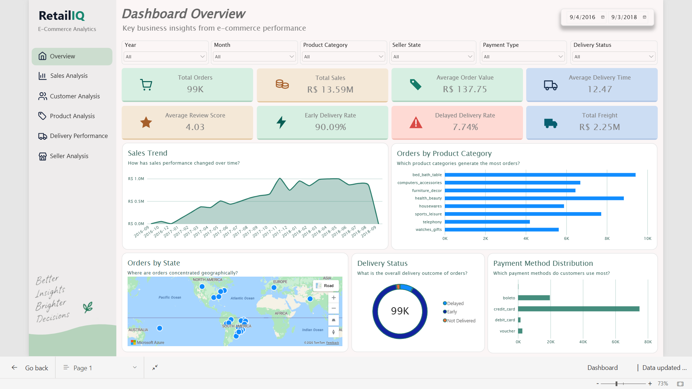
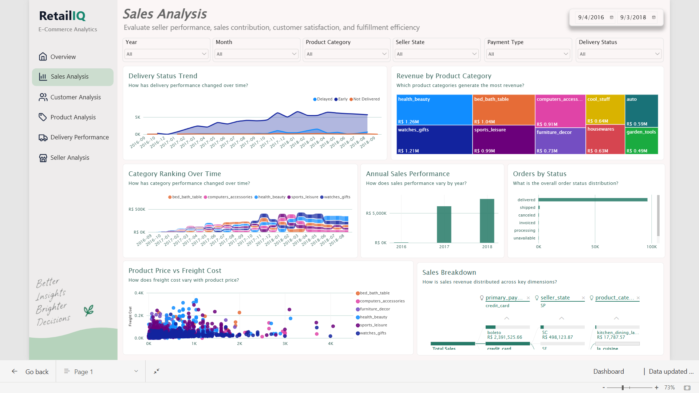
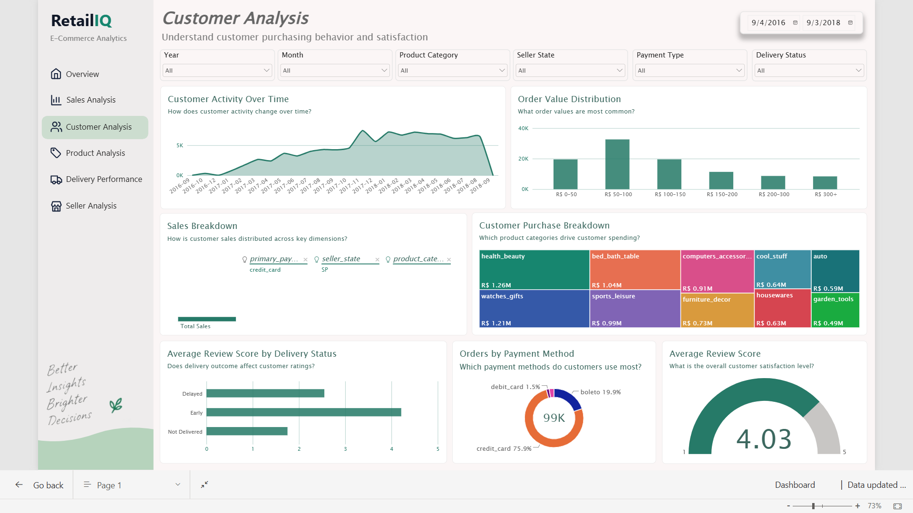
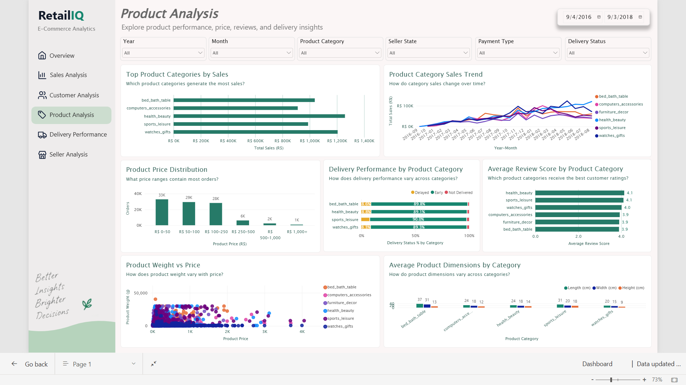
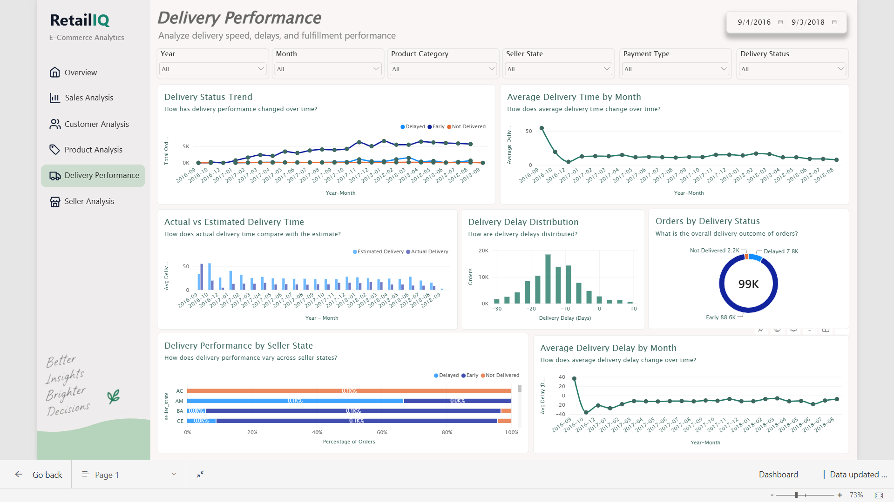
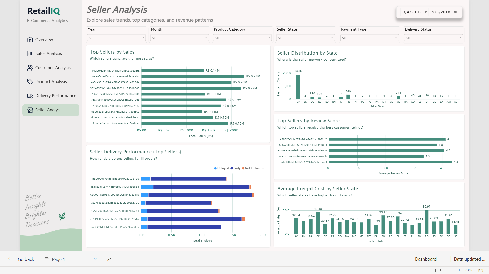

# RetailIQ — E-Commerce Analytics & Machine Learning

RetailIQ is a project where I explored e-commerce data to understand sales, customer behaviour, product performance, and delivery trends. I used Python for data cleaning and analysis, Power BI to build an interactive dashboard, and scikit-learn to experiment with machine learning for delivery delay prediction.

The project uses the Brazilian E-Commerce Public Dataset by Olist.

## Project Objectives

- Explore and understand the available e-commerce datasets.
- Clean and prepare the data for analysis.
- Find patterns in sales, orders, customers, and deliveries.
- Build a Power BI dashboard to present the findings.
- Train and compare machine learning models for delivery delay prediction.

## Project Structure

```text
RetailIQ/
├── dashboard/
│   ├── Dashboard.pbix
│   └── RetailIQ_Dashboard.pbix
├── notebooks/
│   ├── 01_data_understanding.ipynb
│   ├── 02_data_preparation.ipynb
│   ├── 03_exploratory_data_analysis.ipynb
│   └── 04_machine_learning.ipynb
├── images/
│   ├── Dashboard_Overview.png
│   ├── Sales_Analysis.png
│   ├── Customer_Analysis.png
│   ├── Product_Analysis.png
│   ├── Delivery_Performance.png
│   └── Seller_Analysis.png
├── .gitignore
├── README.md
└── requirements.txt
```

## Power BI Dashboard

I created a Power BI dashboard to explore different aspects of the store's performance. It includes separate views for sales, customers, products, delivery performance, and sellers.

Click any screenshot to view it in full size.

## Power BI Dashboard

I created a Power BI dashboard to explore different aspects of the store's performance. It includes separate views for sales, customers, products, delivery performance, and sellers.

Click any screenshot to view it in full size.

### Dashboard Overview

<a href="images/Dashboard_Overview.png">
  
</a>

### Sales Analysis

<a href="images/Sales_Analysis.png">
  
</a>

### Customer Analysis

<a href="images/Customer_Analysis.png">
  
</a>

### Product Analysis

<a href="images/Product_Analysis.png">
  
</a>

### Delivery Performance

<a href="images/Delivery_Performance.png">
  
</a>

### Seller Analysis

<a href="images/Seller_Analysis.png">
  
</a>

## Project Workflow

### 1. Data Understanding

I started by exploring nine related datasets to understand their structure, columns, relationships, and data quality. This helped me identify which datasets and fields would be useful for the analysis.

### 2. Data Cleaning and Preparation

I cleaned and prepared the data and combined relevant information into an order-item-level dataset.

The processed dataset contains:

- **Rows:** 112,650
- **Columns:** 41
- **Duplicate rows:** 0

Processed file: `retailiq_order_item_data.csv`

### 3. Exploratory Data Analysis

I explored order and sales patterns, product and payment information, and delivery performance. I also examined relationships between variables to better understand the data before building the dashboard and machine learning models.

### 4. Power BI Dashboard

I built an interactive dashboard with different views of sales, customers, products, deliveries, and sellers. The goal was to make the findings easier to explore visually.

### 5. Machine Learning — Delivery Delay Prediction

For the machine learning part, I chose to predict whether an order would be delivered later than its estimated delivery date.

The target variable is:

- `1` — Delivered late
- `0` — Delivered on or before the estimated date

I filtered the data to include delivered orders with valid actual and estimated delivery timestamps, then aggregated the eligible records to the order level.

The final modelling dataset contains **96,470 orders**, of which **7,826 (8.11%)** were delayed.

I used a stratified 80/20 train-test split and compared three models:

- Dummy Classifier as a baseline
- Logistic Regression with class weighting
- Decision Tree with class weighting

## Model Results

| Model | Accuracy | Precision | Recall | F1-score |
|---|---:|---:|---:|---:|
| Dummy Classifier | 91.89% | 0.00% | 0.00% | 0.00% |
| Logistic Regression | 52.83% | 9.81% | 58.79% | 16.82% |
| Decision Tree | 70.36% | 14.71% | 55.34% | 23.25% |

The Decision Tree achieved the highest F1-score among the three models. Logistic Regression identified a slightly larger proportion of actual delayed orders, but the Decision Tree had better precision.

The baseline is a useful reminder that accuracy alone can be misleading. Since most orders were not delayed, predicting every order as on time achieved 91.89% accuracy while failing to identify any delayed orders.

The Decision Tree performed better on the balance between precision and recall, but its precision was only 14.71%. Most orders it flagged as delayed were actually delivered on time. So, while the results are useful for learning and comparison, the model would need improvement before it could be relied on in a real business setting.

## What I Learned

- Why understanding and cleaning the data matters before modelling.
- How to combine related datasets and create order-level features.
- How to build and evaluate classification models using scikit-learn.
- Why accuracy is not enough when the target classes are imbalanced.
- How to interpret precision, recall, F1-score, and feature importance.
- Why model results need to be considered in the context of the actual business problem.

## Limitations

- The train-test split is random. A chronological split would be more suitable for testing how the model might perform on future orders.
- Some orders contain products from multiple sellers or categories. The current aggregation simplifies this information by selecting a primary seller state and product category.
- Feature availability needs to be checked carefully for the intended prediction time.
- The Decision Tree produces many false positives, so its predictions should not be treated as reliable delivery warnings yet.
- Sales forecasting remains a possible future extension; it has not been implemented as a separate forecasting model.

## Tools Used

- **Python**
- **Pandas and NumPy**
- **Matplotlib**
- **Scikit-learn**
- **Jupyter Notebook**
- **Microsoft Power BI**
- **Git and GitHub**

## Future Improvements

- Evaluate the models using a chronological train-test split.
- Improve the features used to represent orders with multiple products and sellers.
- Experiment with classification thresholds to reduce false positives.
- Investigate ways to improve the identification of delayed orders.
- Explore sales forecasting as a separate task.

## Dataset

Brazilian E-Commerce Public Dataset by Olist:

https://www.kaggle.com/datasets/olistbr/brazilian-ecommerce

## Project Status

The data preparation, exploratory analysis, Power BI dashboard, and initial delivery delay classification experiments are complete. The project gave me an opportunity to work through the full process, from exploring raw data to building visualizations and evaluating machine learning models. Further model validation and improvements remain open for future work.